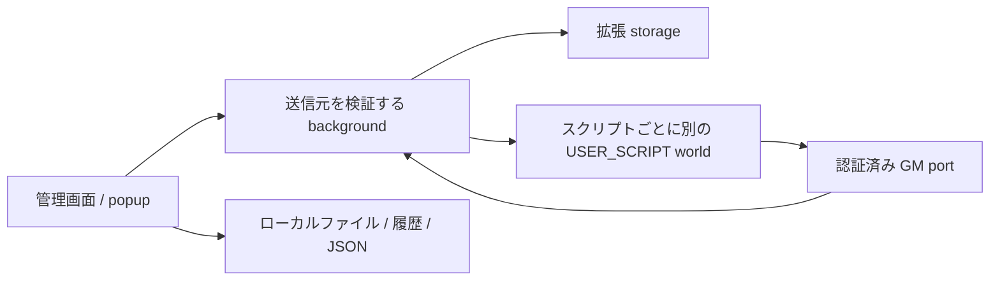

# ShieldMonkey 0.5.0

リンクからの `.user.js` インストールと URL 更新を廃止し、手元のファイル・貼り付け・エディター・ローカルフォルダー同期に統一しました。
管理画面の sandbox iframe と postMessage 中継を削除し、通常の拡張ページへ一本化しています。既存のオプション URL は引き続き利用できます。

## 実行と権限

- 新規追加、GM 権限の増加、対象サイトの変更には確認が必要です。キャンセルした内容は保存しません。
- フォルダー同期・JSON 復元・履歴から入った未承認の変更は無効化し、確認後に有効化できます。ファイル内の承認情報やトークンを信頼しません。
- スクリプトごとに安定した個別 world を使用します。共有の既定 world の通信は無効で、専用 port の初期化に成功するまで本文を実行しません。
- Chromium では現在 1 ドキュメントあたり 10 個の個別 world が上限です。超過分は共有環境で実行せず、停止します。登録件数そのものはこの上限とは別です。実行順序は保証しません。
- Chrome 133 以降、Firefox 142 以降が必要です。必要な分離 API がない環境では弱い方式へ切り替えません。
- `GM_closeTab` / `window.close` も権限を検証します。特権 URL を開く・ダウンロードする要求は拒否します。
- GM 保存値はスクリプトと origin ごとに分離し、拡張 storage と private なメモリーで管理します。同期 `GM_getValue` と書いた直後の読み取りを維持します。保存失敗は通知・ロールバックします。

管理画面の CSP は通常の外部 fetch、外部画像、iframe、動的評価を制限します。承認したスクリプトがページ上で行う操作や、許可された GM_download / GM_openInTab の通信まで遮断する仕組みではありません。DOM はページと共有されます。信頼するコードだけを実行してください。

## 既存データと更新

0.4.3 のスクリプト ID、設定、有効状態、GM 保存値を引き継ぎ、内部トークンだけを一度更新します。以前の許可を超える要求があるスクリプトは確認待ちになります。
GM の旧 storage 値は必要時に新しい領域へコピーし、元の値を削除しません。サイト側の古いキャッシュは、このスクリプトのキーだけを片づけます。
バックアップ、state.json、history に実行用トークンや端末固有の承認記録を含めません。GM 値と拡張設定は従来どおりバックアップ対象外です。

静的 DNR と CORS ヘッダー変更ルールを廃止しました。管理画面からの外部遷移を制限する動的ルール ID 2 は残します。新しい `_metadata` を生成する静的ルールは使いません。

配布 ZIP は **Shieldmonkey-vivaldi.zip** に固定し、直下に manifest.json を置きます。現在読み込んでいるフォルダーの名前・場所を変えず、内容を上書きして、既存の拡張機能を再読み込みしてください。削除・再インストールは不要です。[Android 更新手順](vivaldi-update-ja.txt)

## 検証

`pnpm run test:unit` / `pnpm run lint` / `pnpm run build` / `pnpm run test:e2e` を使用します。E2E は一時プロファイルの Chromium を使います。Linux CI では Firefox の一時アドオンのロードと GM 保存値の再読み込みも検証します。Firefox 検証ツール web-ext 8.9.0 は一時ディレクトリーへインストールし、製品依存には含めません。

[Chrome userScripts API](https://developer.chrome.com/docs/extensions/reference/api/userScripts/)、[Firefox userScripts API](https://developer.mozilla.org/en-US/docs/Mozilla/Add-ons/WebExtensions/API/userScripts)
